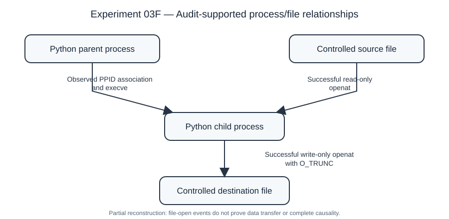

# Independent Research Home Lab — Provenance and SME Incident Investigation

**Research focus:** Investigating the practical value and limitations of provenance-supported intrusion investigation in resource-constrained small and medium-sized enterprise (SME) security operations.

**Status (3 November 2026):** Linux-based feasibility experiments completed through Experiment 03F. Windows, Microsoft 365, cross-platform orchestration, AI-assisted scenarios, and comparative evaluations are **proposed future work**, not implemented results.

> This is an independent research prototype, not a completed provenance-based intrusion detection system (PIDS), and not evidence of a new detection algorithm.

## Research motivation

Security operations teams commonly work with fragmented endpoint, identity, and SIEM alerts. This project asks whether collecting and connecting system-level evidence can improve **what an analyst can reconstruct**, while respecting limited SME infrastructure, staffing, and telemetry budgets.

The distinction between a **verified system relationship**, a **temporal or identity-based correlation**, and a **hypothesized causal link** is central to the research. In particular, an observed file-open system call does not by itself prove that bytes were transferred or that an end-to-end information flow occurred.

## Current independent lab

- **Ubuntu KVM host:** physical Linux system running a Wazuh agent and hosting the Wazuh VM.
- **Wazuh VM:** Ubuntu Server guest with Wazuh 4.14.9 manager, indexer, and dashboard on a private virtual network.
- **Second Ubuntu host:** Wazuh agent, Falco, and Linux Audit used for controlled experiments.
- **Data handling:** experiment artifacts are sanitized before publication; private audit exports, network details, credentials, and employer-specific data are excluded.

The earlier engineering-oriented documentation at the repository root describes a **separate SIEM/SOC project**. It should not be mistaken for evidence that all its enterprise integrations have been deployed in this independent home lab.

## Verified experiments

| Experiment | Demonstrated | What it does not demonstrate |
| --- | --- | --- |
| [01 — Controlled authentication telemetry](experiments/01-controlled-authentication/README.md) | Controlled Wazuh authentication event collection | Provenance-based detection |
| [02A — Falco runtime detection](experiments/02-falco-runtime/README.md) | Falco detection of a controlled host event | Attack reconstruction |
| [02B — Falco to Wazuh ingestion](experiments/02b-falco-wazuh-ingestion/README.md) | Falco JSON ingestion and a Wazuh custom alert | A complete causal graph |
| [03 — Linux Audit partial provenance](experiments/03-linux-audit-provenance/README.md) | Audit-supported process and file-access relationships | Full data-flow causality or intrusion detection accuracy |

**Start with [Experiment 03F: sanitized publication package](experiments/03-linux-audit-provenance/publication/README.md)** for the event interpretation, parser, graph generator, DOT source, SVG figure, reproduction procedure, and limitations.

The four recorded audit events support two Python executions (including a PPID association), a source-file read-only open, and a destination-file write-only open. They do not include a directly observed fork/clone event or prove data flow between the files.

## Research questions

1. Which incident relationships can be established from ordinary SME-accessible telemetry, and which require richer provenance collection?
2. Does provenance-supported reconstruction provide useful additional context compared with SIEM alerts and timelines alone?
3. How do telemetry loss, process-identity ambiguity, collection overhead, and analyst effort affect the practical value of reconstruction?
4. Which conclusions remain defensible when linking operating-system evidence to Windows and cloud-identity logs?

## Proposed cross-platform roadmap — not yet completed

**Phase A — Stronger Linux provenance.** Extend controlled collection to process creation, execution, file and selected network operations; validate event links and missing evidence.

**Phase B — Windows endpoint provenance.** Introduce an isolated Windows test VM with Sysmon, Windows Security logs, and a Wazuh agent. Evaluate process ancestry, persistence, file creation, and network connections. Sysmon alone is not a complete file-read provenance sensor.

**Phase C — Microsoft 365 and identity context.** Use a dedicated test tenant or synthetic data for Entra ID, Defender, and Microsoft 365 audit events. Distinguish identity/event correlation from proven operating-system causality.

**Phase D — Controlled multi-stage and cross-platform scenarios.** Run repeatable, authorized scenarios in an isolated environment, recording ground truth and MITRE ATT&CK mappings. Explore controlled **AI-assisted attack variations** as a future experimental factor, without assuming that such scenarios have been implemented or that AI automatically makes attacks more effective.

**Phase E — Comparative evaluation.** Compare SIEM-only investigation, enriched runtime telemetry, and provenance-supported reconstruction using reconstruction completeness, detection measures where ground truth permits, analyst effort, telemetry-loss robustness, and resource overhead.

The roadmap is a research plan, not a statement of completed functionality or a fixed doctoral proposal.

## Reproducibility and responsible publication

- Publish scripts, configurations, methods, and sanitized visualizations only after review.
- Keep raw audit logs and other identifying evidence private.
- Separate **observed**, **inferred**, and **planned** results.
- Record event identifiers, sensor configuration, versions, ground truth, and limitations.
- Avoid claims of PIDS accuracy, zero-day detection, cross-platform causal reconstruction, or AI-attack resilience without direct experimental evidence.

## Research context

This prototype supports an ongoing BCIT cybersecurity research project and an exploration of future research questions in system provenance, intrusion detection, and observability. It is intended as a **feasibility study and research conversation starter**, not a finished paper or a production security product.
