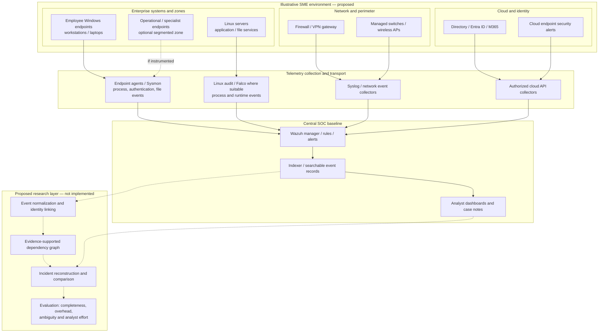

# 00 — SME SOC Reference Architecture (Proposed)

**Research context:** Small and medium-sized enterprise (SME) security operations  
**Status:** Conceptual reference architecture — **not a deployed enterprise network**  
**Relationship to the lab:** Defines the target operating environment and the scope of future experiments.

## 1. Purpose and boundaries

This architecture represents a plausible SME environment with heterogeneous endpoints, network infrastructure, identity services, and a small SOC function. It is a **research model**, not a diagram of an actual employer or customer network. The independent home lab currently implements only a small subset of it, as documented in [01 — Implemented Home Lab Network Architecture](01-network-architecture.md) and the [current architecture map](02-home-lab-architecture-map.md).

The research goal is to assess whether provenance-oriented evidence can improve security incident reconstruction relative to conventional alert and event correlation under practical constraints: limited staff, compute, storage, instrumentation coverage, and investigation time.

## 2. Proposed SME network and SOC data flow

**Legend:** Solid arrows describe conventional intended telemetry paths in the *reference design*; dashed arrows indicate conditional instrumentation or proposed research processing. The diagram does **not** assert that these sources or integrations are currently operating in the independent lab.

## 3. SME assets and candidate evidence

| Environment | Candidate sources | Investigative questions | Key limitations |
|---|---|---|---|
| Windows endpoints | Security logs, Sysmon, endpoint alerts | Which account or process initiated an action? What executed next? | Collection configuration, event loss, process identity ambiguity |
| Linux servers | Audit events, process/runtime telemetry, authentication logs | Which process accessed a file or opened a connection? | Instrumentation overhead and incomplete dependency capture |
| Firewall and VPN | Traffic, threat, VPN authentication logs | Was a connection allowed, denied, or linked to a session? | Network events rarely prove host-level causality |
| Switches and wireless | Syslog and device state events | Was connectivity disrupted or an unexpected device observed? | Sparse identity/context and varying vendor schemas |
| Identity and cloud | Sign-in, directory changes, security incidents | Which principal authenticated or changed access? | API permissions, retention, clock alignment, cross-system identity |
| Specialist / OT-adjacent devices | Available host or network events | Can incidents be investigated with limited endpoint instrumentation? | Legacy systems, safety requirements, restricted sensor deployment |

These are **candidate** sources. They are not a claim that each is installed or supported in the current home lab.

## 4. Mapping the reference environment to the actual home lab

| Reference component | Current independent lab analogue | State |
|---|---|---|
| Central SIEM | Wazuh 4.14.9 all-in-one VM | Implemented |
| Linux endpoint telemetry | Two Ubuntu physical hosts with Wazuh agents | Implemented; previously verified active |
| Transport between network zones | Restricted TCP relays into libvirt NAT | Implemented; selected validation pending |
| Windows endpoint / Sysmon | None documented in independent lab | Planned |
| Firewall, wireless and VPN telemetry | No such feed documented in independent lab | Planned / optional |
| Cloud identity telemetry | No cloud API feed documented in independent lab | Planned / optional |
| Falco and Linux Audit instrumentation | Controlled experiments on second Ubuntu host | Implemented for documented test runs |
| Process/file relationship reconstruction | Manually reconstructed audit-supported graph in Experiment 04 | Preliminary feasibility only; automated graph construction planned |
| Controlled feasibility experiments | Experiments 01–04 documented | Implemented; comparative attack protocol planned |

The small lab is an experimental **subset**, not a miniature enterprise whose scale or representativeness has already been established.

## 5. Trust boundaries and configuration principles

1. Keep the research environment independent of any employer or customer infrastructure.
2. Segment test systems where possible; restrict access to SIEM management interfaces and ingestion ports.
3. Use authenticated and encrypted transport where supported; a source-IP filter is not sufficient security by itself.
4. Minimize collection of personal data and avoid committing raw logs or secrets to GitHub.
5. Document clock synchronization, sensor versions, retention, event schemas, and collection gaps.
6. Do not perform intrusive tests on business systems or unmanaged third-party assets.

## 6. Provenance research: what must be established

A SIEM alert is an observation or rule result. A chronological sequence can support investigation but does not, on its own, prove causation. A defensible provenance graph requires suitable evidence for dependencies such as **process spawned process**, **process read/wrote file**, or **process established connection**. Cross-host and cloud-to-host dependencies may remain uncertain even when timestamps align.

The research will therefore compare:

- **Baseline:** Alert-centric investigation and time-ordered event correlation.
- **Experimental method:** Evidence-supported dependency reconstruction from suitably instrumented sources.
- **Outcome measures:** Reconstruction completeness, unsupported causal links, missing-event sensitivity, analyst effort, and resource overhead.

No performance or accuracy claims are made before experiments are conducted.

## 7. Phased implementation

**Phase 1 — Completed baseline:** Two Linux agents reporting to a Wazuh VM, with restricted forwarding from the second host.

**Phase 2 — Completed preliminary experiments:** Controlled authentication, Falco runtime/ingestion, and Linux Audit process/file-access experiments 01–04; see [research home lab](../README.md).

**Phase 3 — In progress / planned:** Extend observed Linux process/file dependencies to network and cross-host evidence, automate reproducible graph assembly, and establish a comparable Wazuh-only investigation baseline.

**Phase 4 — Planned:** Introduce controlled telemetry gaps and resource measurements, document limitations, and assess transferability to an SME setting.

## 8. Scope statement for readers

This document is a **proposed SME SOC reference architecture**. The separate [implemented home lab architecture](01-network-architecture.md) is the authoritative record of what has actually been deployed and verified. The enterprise-oriented materials elsewhere in the repository are historical engineering documentation and should not be interpreted as evidence of current independent-lab integrations.
