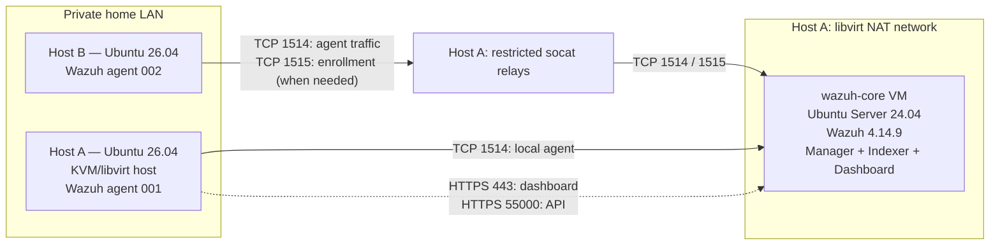

# 01 — Network Architecture and Telemetry Path

**Project:** Independent Research Home Lab  
**Status:** Implemented baseline; selected checks pending  
**Recorded environment:** October 2026  
**Scope:** Personally operated systems only. No employer network, endpoints, or telemetry are part of this environment.

## 1. Objective

The first laboratory phase provides a reproducible security-monitoring baseline against which later incident-reconstruction experiments can be evaluated. The architecture deliberately uses modest physical resources and a virtualized SIEM server to reflect constraints relevant to smaller security operations.

This document describes the **implemented** Wazuh deployment. Falco, additional data sources, graph construction, and provenance-aware detection are **future work** for this independent laboratory.

## 2. Topology



Addresses are intentionally omitted. The VM's private NAT address is reachable from Host A, but not directly routable from Host B because the physical machines use separate libvirt NAT networks.

## 3. Component inventory

| Component | Platform / allocation | Role | Observed state |
|---|---|---|---|
| Host A (`soc-core`) | Ubuntu 26.04 LTS, AMD Ryzen 7 4700U, approximately 14 GiB RAM | Hypervisor, local agent, relay host | Operational |
| `wazuh-core` VM | Ubuntu Server 24.04 LTS, 4 vCPU, 8 GiB RAM, 100 GB virtual disk, 4 GB swap | Wazuh manager, indexer and dashboard | Operational |
| Host B (`ubuntusg`) | Ubuntu 26.04 LTS, approximately 6.7 GiB RAM | Second physical telemetry source | Agent connected |
| Wazuh agents | Version 4.14.9 | Endpoint event collection | Agents 001 and 002 previously observed active |
| Relay services | `socat` managed by systemd on Host A | Forward selected Wazuh agent TCP traffic into VM NAT | Enabled and active |

Hardware allocations and observed states reflect the recorded setup, not a capacity benchmark.

## 4. Network and data flows

### 4.1 Host A agent to Wazuh VM

Host A's Wazuh agent communicates with the VM over the local libvirt NAT network using **TCP 1514**. The VM is hosted on Host A, so this path does not require the LAN-facing relay.

### 4.2 Host B agent to Wazuh VM

Host B connects to Host A's LAN-facing interface. Host A runs two `socat` listeners:

| TCP port | Purpose | Relay destination |
|---|---|---|
| 1514 | Agent event transport | Wazuh VM TCP 1514 |
| 1515 | Agent enrollment, when required | Wazuh VM TCP 1515 |

Each relay is restricted to Host B's source address using `socat`'s `range` option. The services are managed by systemd, with restart-on-failure behavior.

**Security qualification:** Source filtering is a basic access restriction, not a substitute for authenticated transport, host firewall policy, or network segmentation. A TCP handshake alone does not establish that the relay accepted and forwarded application data.

### 4.3 Management access

The Wazuh dashboard is available to Host A over HTTPS. The Wazuh REST API is reachable on **HTTPS TCP 55000**; an unauthenticated request returned HTTP 401, confirming that the endpoint responded but required authentication. Successful API authentication and agent inventory export remain to be documented.

## 5. Validation record

| Check | Evidence recorded | Result |
|---|---|---|
| Wazuh manager, indexer and dashboard installation | VM deployment and successful dashboard access | Verified in setup session |
| Host A agent enrollment | Agent ID 001 active in dashboard | Verified previously |
| Host B agent enrollment | Agent ID 002 active in dashboard | Verified previously |
| Host B agent session | Established TCP connection to Host A relay, with forwarding into VM | Verified |
| systemd relay services | Both relay units enabled and active; listeners observed | Verified |
| Unauthorized source to enrollment relay | `socat` journal reported refusal due to `range` option on TCP 1515 | Verified |
| Unauthorized source to event relay | Same restriction configured on TCP 1514 | Configured; rejection not independently tested |
| API reachability | HTTPS 55000 returned HTTP 401 without credentials | Verified |
| Authenticated API access | JWT acquisition was not confirmed | Pending |
| Relay persistence across full reboot | Services enabled, but end-to-end post-reboot test not recorded | Pending |
| Resource and event-loss measurements | No formal measurements yet | Planned |

## 6. Architectural decisions and trade-offs

**Virtualized all-in-one Wazuh server.** A single VM simplifies setup and reduces hardware requirements. It also creates a single point of failure and couples manager, indexer and dashboard resource consumption. The design is suitable for a small experimental baseline, not a claim of production high availability.

**NAT rather than a bridged VM.** Libvirt NAT avoids directly exposing the SIEM VM to the LAN. It also prevents Host B from directly reaching the VM and therefore requires an explicit transport path.

**Restricted TCP relay.** `socat` forwarding was selected as a practical solution for the existing topology. It adds a dependency on Host A and provides no additional end-to-end authentication by itself. Future work may compare this design with routed or bridged alternatives.

**Two physical telemetry sources.** Separating Host B from the hypervisor provides a basic cross-host collection scenario. Two agents are insufficient for statistical conclusions about scalability, detection accuracy, or general SME performance.

## 7. Reproducibility and safety

Public examples must use placeholders such as `<HOST_A_LAN_IP>`, `<WAZUH_VM_IP>`, and `<HOST_B_LAN_IP>`. Never publish live passwords, tokens, private keys, unredacted agent logs, personal identifiers, or sensitive infrastructure details.

Example relay **pattern only** (not a complete deployment script):

```bash
socat TCP-LISTEN:1514,bind=<HOST_A_LAN_IP>,reuseaddr,fork,range=<HOST_B_LAN_IP>/32 TCP:<WAZUH_VM_IP>:1514
```

The corresponding enrollment relay uses TCP 1515. Before adopting the pattern, review host firewall rules, authentication, and whether a relay is appropriate for the target topology.

## 8. Relationship to the research question

A conventional SIEM can collect events and issue alerts, but alerts do not automatically establish the causal dependencies between processes, files, users and network activity. This laboratory will provide the initial event collection baseline. Subsequent experiments will distinguish:

- **Alert correlation:** associating events by rule, time, host, user or indicator.
- **Incident timeline:** ordering observed events in time.
- **System provenance:** representing defensible causal relationships supported by suitable instrumentation and evidence.

The experimental question is not whether a timeline can be drawn, but whether provenance-oriented evidence materially improves reconstruction quality and analyst understanding under constrained telemetry and computing resources.

## 9. Next validation tasks

1. Capture sanitized screenshots showing the Wazuh dashboard and both agent identities/statuses.
2. Complete authenticated API access and export a redacted agent inventory.
3. Perform a documented reboot-persistence test of both relay services and the Host B agent path.
4. Record baseline CPU, memory, storage, ingestion and event-loss observations.
5. Define the first controlled event-reconstruction experiment and its expected evidence.

**Document integrity note:** All validation claims above refer to recorded setup observations; no new live checks were performed while authoring this document.
