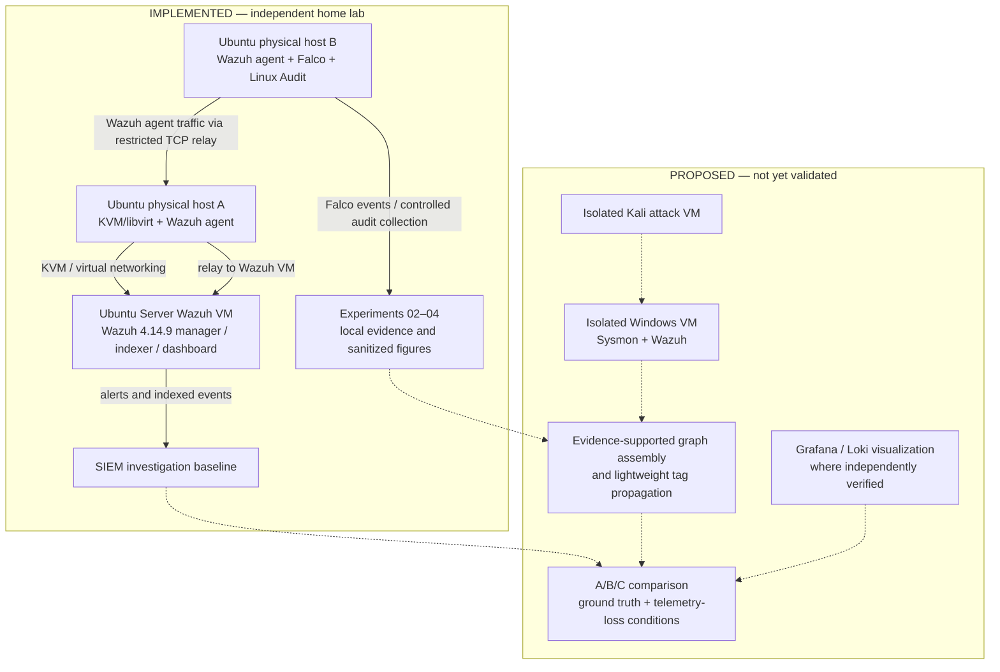

# Independent Home Lab — Architecture and Research Boundary

**Status:** Implemented baseline and documented experiments, with explicitly separated future components.  
**Scope:** Independent research environment; not a diagram of an employer network.

**Interpretation:** Solid arrows represent implemented or documented local pathways; dashed arrows indicate research intentions, not deployed functionality. The current Linux Audit graphs are manually constructed and are **not** proof of automated provenance detection.

## Research design mapping

| Layer | Verified today | Future work |
| --- | --- | --- |
| Collection | Ubuntu Wazuh agents, Falco, Linux Audit | Windows Sysmon, additional network and identity telemetry |
| SIEM | Wazuh VM and controlled event ingestion | Controlled SIEM-only baseline under multi-stage attacks |
| Provenance | Selected process-creation and file-open edges from Experiment 04 | Validated graph assembly, tag propagation, network and credential dependencies |
| Comparison | Preliminary feasibility observations | Configurations A/B/C, common ground truth, 0/10/25% event loss |
| Reproducibility | Experiment scripts, sanitized figures and methods | Frozen sensor configs, drop seeds, complete trial records and analyst-study protocol |

See [implemented network architecture](01-network-architecture.md), [reference SME architecture](00-sme-reference-architecture.md), and [research rationale](../research/README.md).

**Security:** All topology descriptions intentionally omit addresses, credentials, employer infrastructure, and raw logs.
