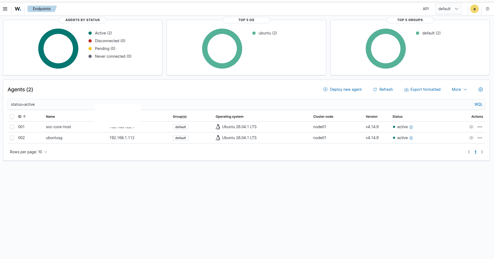
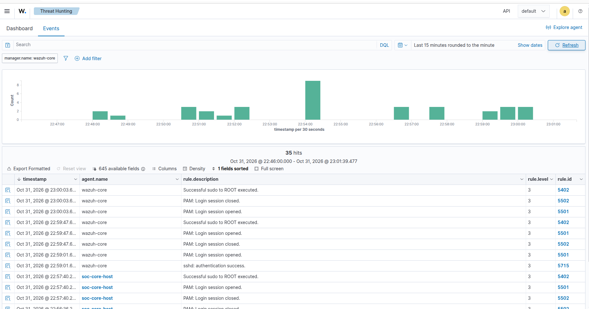
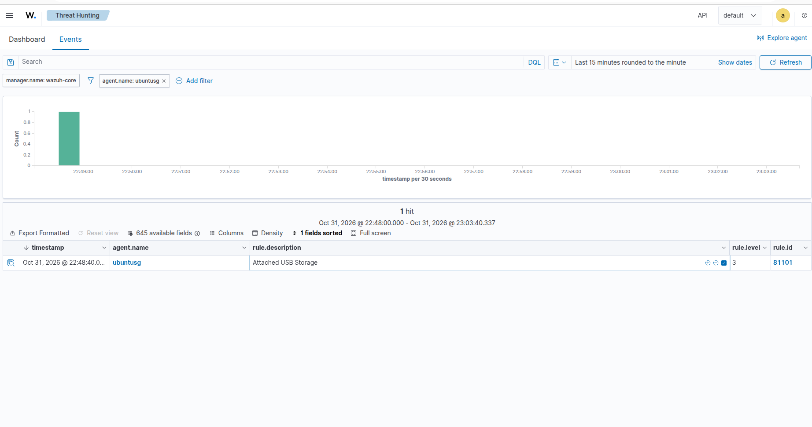
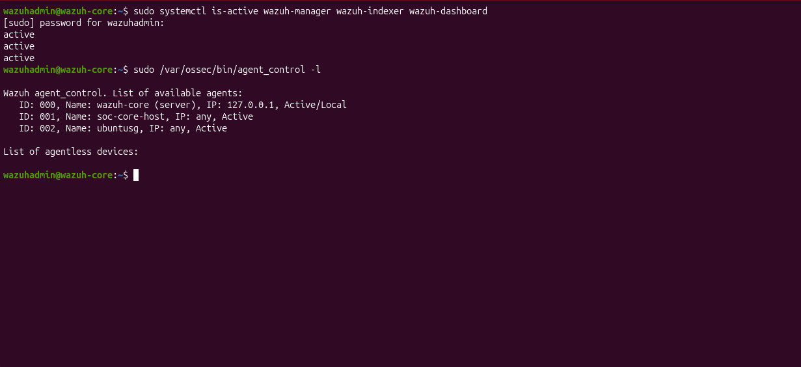

# 03 — Verified SIEM Baseline (October 31, 2026)

**Status:** Verified operational baseline; not a provenance-enabled experiment.  
**Environment:** Independent personal home lab; no employer systems or data.  
**Evidence date:** October 31, 2026 (local lab time).  
**Evidence type:** Operator command outputs and Wazuh dashboard screenshots, reviewed during the validation session. Raw screenshots are not published because they include internal network addresses.

## Scope

Validate that the independently hosted Wazuh installation is operational, that both Linux endpoints have active agents, and that each endpoint produces at least one searchable security alert. This is a **functional baseline**, not proof of complete event capture, causal reconstruction, or attack-detection accuracy.

## Observed architecture

- **Machine A:** Ubuntu 26.04.1 LTS physical host; KVM/libvirt hypervisor; Wazuh agent v4.14.9, ID 001, `soc-core-host`.
- **Wazuh VM:** Ubuntu 24.04.5 LTS guest on Machine A, running Wazuh manager, indexer, and dashboard. Manager's local agent is ID 000.
- **Machine B:** Ubuntu 26.04.1 LTS physical host; Wazuh agent v4.14.9, ID 002, `ubuntusg`.
- **Transport:** Machine A hosts two active TCP relay services for Wazuh agent communication/enrollment. The relays were checked for active state, but restart persistence and network-path fault tolerance were **not** tested during this session.

Network addresses, SSH host keys, credentials, and private configuration details are intentionally omitted.

## Validation evidence

| Check | Observation | Assessment |
|---|---|---|
| KVM guest | `virsh list --all` showed `wazuh-core` running | Pass |
| Relay services | `wazuh-relay-1514` and `wazuh-relay-1515` both `active` | Pass (runtime only) |
| Machine A agent service | `wazuh-agent` `active` | Pass |
| Machine A agent state | `/var/ossec/var/run/wazuh-agentd.state` reported `status='connected'` | Pass |
| Wazuh VM services | `wazuh-manager`, `wazuh-indexer`, and `wazuh-dashboard` all `active` | Pass |
| Manager agent listing | ID 000 `wazuh-core` Active/Local; ID 001 `soc-core-host` Active; ID 002 `ubuntusg` Active | Pass |
| Dashboard endpoint status | 2 active Ubuntu agents, 0 disconnected, 0 pending | Pass |
| Machine A alert ingestion | Threat Hunting displayed `soc-core-host` authentication/PAM/sudo alerts; examples: rules 5402, 5501, 5502 | Pass |
| Machine B alert ingestion | Threat Hunting displayed one `ubuntusg` event, “Attached USB Storage,” rule 81101, level 3 | Pass |

The dashboard also displayed SSH authentication success (rule 5715) for the Wazuh VM itself. This is **not** evidence of an SSH event on Machine B.

## Commands used

On Machine A:

```bash
sudo virsh list --all
sudo systemctl is-active wazuh-relay-1514 wazuh-relay-1515
sudo systemctl is-active wazuh-agent
sudo grep -E '^(status|manager_host|agent_id|agent_name)=' /var/ossec/var/run/wazuh-agentd.state
```

Inside the Wazuh VM:

```bash
sudo systemctl is-active wazuh-manager wazuh-indexer wazuh-dashboard
sudo /var/ossec/bin/agent_control -l
```

Dashboard verification: **Endpoints** for agent status; **Threat Hunting → Events**, filtered by `agent.name`, for indexed alert evidence.

## What is not yet established

1. An arbitrary `logger` test message was suggested, but its ingestion was **not** demonstrated; normal Wazuh alert views may omit messages that do not match alerting rules.
2. Agent connectivity and a few indexed alerts do not prove complete raw-log capture, telemetry fidelity, or causal relationships.
3. No controlled multi-stage attack, ground-truth event sequence, provenance graph, or reconstruction accuracy has yet been validated.
4. No restart/reboot persistence, telemetry-loss experiment, resource benchmark, or analyst timing measurement was performed.
5. A displayed USB attachment alert is evidence of an indexed alert, not independent confirmation of the physical device action.

## Next validation

Run a **safe, timestamped, reproducible authentication-event test** on Machine B; record ground truth and matching manager/indexed alerts; then specify a baseline event-reconstruction protocol before introducing Falco or provenance instrumentation.

See [network architecture](01-network-architecture.md) and [SME reference architecture](00-sme-reference-architecture.md).


## Screenshot evidence (published October 31, 2026)

Four sanitized PNG screenshots from the October 31 validation session were uploaded to this research branch in commit `4a9f628`.

| Intended repository path | Demonstrates | Important limitation |
|---|---|---|
| `evidence/01-wazuh-agents-active.png` | Two active Wazuh agents and versions | Agent status does not prove event completeness |
| `evidence/02-machine-a-security-alerts.png` | Indexed sudo/PAM events from Machine A | Alerts do not establish a complete causal chain |
| `evidence/03-machine-b-security-alerts.png` | Indexed USB storage alert from Machine B | An alert is not independent verification of physical USB activity |
| `evidence/04-wazuh-services-active.png` | Manager, indexer, dashboard, and agent listing | Service activity does not prove performance or resilience |

**Publication rule:** Preserve original screenshots privately; review published images for inadvertent disclosures. Do not publish browser addresses, private network addresses, secrets, personal identifiers, or employer-specific telemetry. If a screenshot is redacted, describe the redaction without implying that it is an unaltered capture.

**Evidence status:** Service and event observations verified from original captures; four sanitized screenshots published.

## Visual evidence

### Active agents



### Machine A authentication alerts



### Machine B USB alert



### Core service and agent health



Screenshots illustrate the observations above, not completeness of telemetry or provenance-based causal reconstruction.
