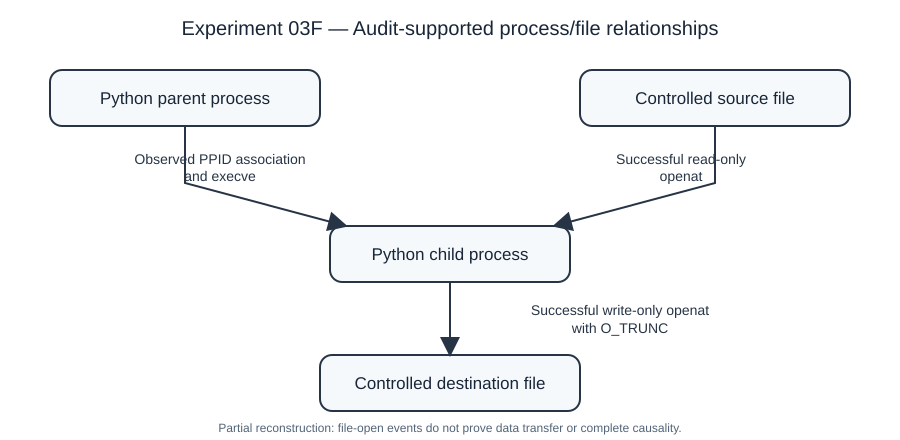

# Experiment 03F — Public figure and reproducibility package

**Branch:** `research-homelab`  
**Experiment:** `SOCEXP03F-20261103-000558`  
**Status:** Controlled execution and local graph validation completed; sanitized Python scripts, DOT source, and an accessible SVG figure published. The original PNG is retained locally and is not uploaded.

## Purpose

Demonstrate how a narrowly scoped Linux Audit collection can support a **partial, audit-supported process/file relationship graph** using a controlled benign Python scenario. This is not a complete system-provenance graph, nor evidence of malicious activity.

## Locally verified observations

| Audit serial | Observation | Interpretation |
| --- | --- | --- |
| 703 | Successful parent Python `execve` | Parent process execution observed |
| 704 | Successful child Python `execve`, with PPID matching parent PID | Parent-child association observed; no `fork`/`clone` event collected |
| 705 | Successful child `openat` with read-only access to controlled source file | Source file opened for reading |
| 706 | Successful child `openat` with write-only, create and truncate flags on controlled destination | Destination file opened for writing/truncation |

The observed file-open operations alone do not establish bytes transferred, content provenance, or an end-to-end causal dependency between files. A controlled output check was performed locally, but the figure deliberately represents only relationships supported by the audited system calls.

## Planned public artifacts

- [`scripts/audit_parser.py`](scripts/audit_parser.py) — audit-event parser (published).
- [`scripts/build_graph.py`](scripts/build_graph.py) — generator with event and access-mode validation (published).
- [`figures/provenance-03f-public.dot`](figures/provenance-03f-public.dot) — sanitized Graphviz source (published).
- [`figures/provenance-03f-public.svg`](figures/provenance-03f-public.svg) — accessible sanitized vector illustration (published; equivalent relationships, redrawn for readability).
- `figures/provenance-03f-public.png` — original rendered PNG (verified locally; **not uploaded**).

The linked files above have been committed to GitHub. The original `ausearch --raw` records, local manifest, `SHA256SUMS.txt`, original figures, and backup scripts remain outside the public repository.

## Local verification already performed

- Four raw audit event exports (703–706) were retained locally.
- A local SHA-256 manifest verified four event exports, the original graph generator, original DOT, and original PNG.
- A publication graph generator validated two process executions and two file-access events.
- Graphviz rendered the sanitized publication figure as a 762 × 451 PNG after spacing adjustment.
- A targeted text scan of the public DOT and generator found no matches for the specified username, host, private-address pattern, absolute home-path pattern, or known experiment PID/inode identifiers.
- Audit rule cleanup was confirmed with `auditctl -l` returning `No rules`; a final `auditctl -s` check showed `lost 0`.

The targeted identifier scan is **not** a comprehensive secrets audit. The actual publication artifacts must receive a final content review before upload.

## Reproduction workflow

On a trusted Linux laboratory system with Python 3 and Graphviz, after placing the **private** audit exports in a local evidence directory:

```bash
python3 scripts/audit_parser.py /path/to/private/evidence/03f
python3 scripts/build_graph.py /path/to/private/evidence/03f figures/provenance-03f-public.dot
dot -Tpng figures/provenance-03f-public.dot -o figures/provenance-03f-public.png
```

The published generator uses explicit input/output arguments; the private evidence exports are not published. The published figure is sanitized and therefore does not itself contain the underlying audit serials, PIDs, inode identifiers, or host identity.

## Limitations

This experiment uses a deliberately benign and known scenario. It does not measure intrusion-detection precision/recall, resilience to telemetry loss, graph completeness, analyst effort, or causal information flow. A stronger study would collect process-creation events and correlate stable process identities and actual read/write observations while explicitly quantifying missing telemetry.

See the parent [Experiment 03 README](../README.md), [methodology](../methodology.md), and [results](../results.md) for the broader experimental record.

## Public illustration



The SVG is a clean, accessibility-oriented redraw of the relationships represented in the locally generated DOT/PNG; it is **not** the byte-identical Graphviz PNG.
